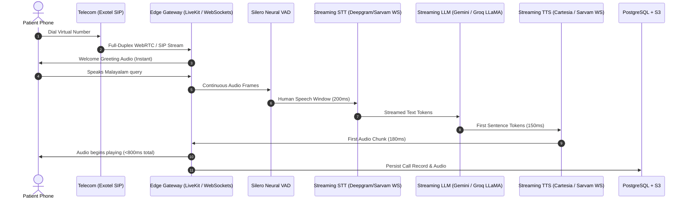

# ClinicVoice System Architecture (ARCHITECTURE.md)

**Product Working Name:** ClinicVoice  
**Launch Partner:** Sreerudra Ayurveda Hospital & Research Centre, Alappuzha, Kerala  
**Version:** 1.0 (Phase 4 Complete)  

---

## 1. High-Level Architecture Overview

```text
[ Patient Phone (Kerala) ]
           │
           ▼ (Cellular E.164)
  [ Exotel SIP Trunk ]
           │
           ▼ (SIP over TLS/SRTP)
[ LiveKit Voice Gateway ] ──► [ VoiceAgentWorker ]
                                    │
                  ┌─────────────────┴─────────────────┐
                  ▼                                   ▼
          [ Speech Pipeline ]                 [ Backend Tools ]
          - Silero VAD                        - find_or_create_patient
          - Sarvam STT (ml-IN / en-IN)        - get_free_slots
          - Claude / GPT / Gemini LLM         - book_appointment
          - Sarvam Bulbul TTS (ananya/meera)  - escalate_emergency
                  │                                   │
                  └─────────────────┬─────────────────┘
                                    ▼
                [ FastAPI Application (Backend API) ]
                                    │
          ┌─────────────────────────┼─────────────────────────┐
          ▼                         ▼                         ▼
  [ PostgreSQL + RLS ]      [ Redis Caching ]       [ Storage & Sweeper ]
  - Tenant isolation        - Session state         - MinIO / AWS S3
  - Audit logging           - Rate limiting         - 30-day retention
  - Booking locks           - Fast queues           - Purge cron worker
                                    ▲
                                    │ (REST / JSON)
                        [ Next.js Staff Dashboard ]
                        - Realtime quick stats
                        - Call recordings & waveform audio
                        - Turn-by-turn bilingual transcripts
                        - Doctor timetable & calendar slots
```

---

## 2. Core Subsystems

## 2.3 Live Telephony & Speech Gateway (`backend/app/api/webhooks_exotel.py`)
* **Transport:** Full-duplex WebSocket AudioStreams bridge (`/webhooks/exotel/voicebot`) directly interfacing Indian carrier network virtual numbers (`0495...`).
* **Audio Format:** 8kHz 16-bit linear PCM mono streaming.
* **VAD & Silence Detection:** Adaptive 380ms silence pause detector triggering immediate end-of-turn processing.
* **Pipelined Low-Latency TTS:** Sentence-by-sentence streaming synthesis via Sarvam Bulbul TTS (`bulbul:v3`), streaming sentence 1 in ~1.0s while concurrently synthesizing subsequent sentences in the background.
* **Intelligent Call Termination:** Farewell intent detector listening for closing phrases ("ശരി", "നന്ദി", "ഓക്കേ", "thank you", "bye") or post-booking completions to play goodbye audio and cleanly drop the carrier call without dead air.

---

## 3. Active AI Models & Provider Inventory

| Layer | Model / Service | Provider | Purpose & Parameters |
| :--- | :--- | :--- | :--- |
| **Telephony Gateway** | Exotel AudioStreams | Exotel | Full-duplex WebSocket streaming 8kHz PCM over carrier line |
| **Speech-to-Text (STT)** | `saaras:v3` | Sarvam AI | Regional Malayalam speech recognition (`ml-IN`) |
| **Reasoning Engine (LLM)**| `gemini-3.5-flash-lite` | Google AI | Hospital slot booking, clinical guardrails, triage, `maxOutputTokens: 55`, `temp: 0.2` |
| **Text-to-Speech (TTS)** | `bulbul:v3` | Sarvam AI | Native Malayalam female voice (`kavya`), `speech_sample_rate: 8000`, `pace: 1.10` |
| **Knowledge Engine** | `hospital_knowledge.json` | Dynamic Context | Centralized JSON store for doctors, slots, fees, FAQs |
| **Call Recording & Storage**| RIFF 8kHz WAV + JSON | Local / S3 | Mixed stereo audio recording and turn-by-turn bilingual transcripts |

---

## 4. Production Scale Roadmap (<800ms Latency & High Accuracy)



### 2.3 Voice Agent Core (`backend/agent/`)
* **LiveKit SIP Integration:** Receives inbound telephone streams.
* **Consent Gating (`recording.py`):** Audio is kept in-memory; persisted to storage only if caller gives explicit recording consent.
* **Bilingual Engine (`language.py`):** Dynamic switching between Malayalam (`ml-IN`), English (`en-IN`), and Manglish.
* **Guardrails:** Refuses medical advice / drug prescriptions and escalates life-threatening emergencies immediately.

### 2.4 Staff Web Dashboard (`frontend/`)
* **Framework:** Next.js 14 App Router, React 18, Tailwind CSS, Lucide icons.
* **Pages:** Home (`/`), Calls (`/calls`), Appointments (`/appointments`), Knowledge Base (`/knowledge`), Settings (`/settings`).
* **Audio Player:** Waveform visualization with signed MinIO playback links.
